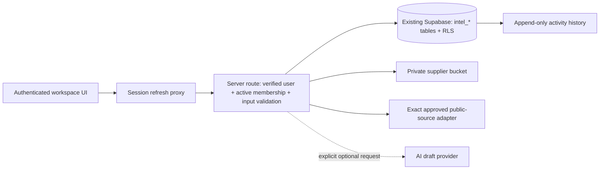

# Evolution Engine architecture and security

## Boundaries

The public pages do not receive private records. Workspace/login/protected API routes are no-index and no-store. No service-role key is required or exposed. Requests use the signed-in user's JWT so RLS is always applied. Auth is verified with `getUser`, not a client-supplied identity or an unverified cookie. Supabase sessions are refreshed by `src/proxy.ts`; cookies are HttpOnly, SameSite=Lax and Secure in production. Both pages and each API operation enforce membership independently.

## Data model

- `intel_members`: existing Auth identities with admin/analyst/viewer roles and revocation flag.
- `intel_sources` → `intel_signals`: provenance, dates, reliability, review, factual/claim/AI classification.
- `intel_opportunities` ↔ signals through `intel_evidence`: explicit supporting or contradicting interpretations.
- `intel_organizations` → `intel_contacts`, `intel_notes`, and `intel_suppliers`.
- `intel_categories` → suppliers; each supplier has documented diligence and privately stored `intel_documents`.
- `intel_supplier_reviews`: attributable, immutable human qualification reviews.
- `intel_links`: opportunity-to-supplier or opportunity-to-organization relationship, exactly one target per row.
- `intel_tasks`: validation/follow-up actions, internal owner, date, criterion and outcome.
- `intel_evaluations` + `intel_weights`: criterion-level reasoning and conservative weighted calculation.
- `intel_decisions` → `intel_decision_evidence`: attributed lifecycle changes and source links.
- `intel_activity`: database-generated append-only operational history, no full document/message dumps.

All primary records have UUIDs, created/updated times, attributable actors and optional synthetic batch tags. Foreign keys restrict unsafe removals. Time/stage/due-date/relationship indexes support the initial UI. The schema avoids changes to pre-existing application tables or policies.

## Permissions

| Actor | Read intelligence/files | Create/update operational data | Weights / ingestion approval | Membership | Approval/stage transition |
| --- | --- | --- | --- | --- | --- |
| Anonymous / non-member | Denied | Denied | Denied | Denied | Denied |
| Viewer | Allowed | Denied | Denied | Read active members | Denied |
| Analyst | Allowed | Allowed by RLS | Denied | Read active members | Explicit rationale + DB gates |
| Administrator | Allowed | Allowed by RLS | Allowed | Managed through authorized DB administration | Same human-review gates |

The app uses no privileged database bypass. Direct authenticated REST access is subject to the same policies. Membership grants cannot be self-issued through the app. Only the current user's synthetic batches may be deleted; audit and decision/review history cannot be rewritten by clients.

## Transactions and invariants

- Signal conversion and evidence linking commit together.
- Decision, evidence links and opportunity stage change commit together. Direct stage changes without an attributable recent decision are rejected.
- Relationship note and dated follow-up task commit together.
- Supplier qualification requires a current human review and verified supporting documentation. No model score triggers approval.
- Scorecards are saved together with nine unique criterion entries. Unknown values remain unknown.
- Synthetic cleanup is all-or-nothing and fails if real records depend on a demonstration record.
- Uploads are bounded; generated object keys stay under a real supplier's UUID. Metadata failures trigger compensating object cleanup. This cross-service operation is not a single database transaction; operational review should reconcile any rare orphaned objects.

## Threat handling and practical limits

Same-origin writes, authenticated per-request checks, payload schemas, streamed size limits, exact ingestion destinations, rejected redirects/XML entities, private Storage RLS, expiring attachment links and no secret logging reduce common misuse paths. Original source URLs are linked, never treated as fetch instructions. Source content sent to optional AI is explicitly untrusted, outputs cannot invoke tools, and source IDs/URLs are checked against supplied evidence. AI prose still requires human verification.

Supabase applies Auth controls; RLS is the authorization boundary, not the UI's disabled buttons. Deploy behind Vercel/your existing authenticated infrastructure; configure project Auth redirects and account policies with the application owner. External supplier files require operational malware protection before large-scale intake. Do not use this tool for patient records or clinical decisions without a separate review of those requirements.

## Validation layers

1. Model tests: conservative score/coverage/confidence, input validation, ingestion SSRF/entity rejection, AI grounding contract, streamed body limits.
2. Disposable PostgreSQL: actual migration/RPC/RLS, distinct roles and outsider, human supplier gates, lifecycle atomicity, links/tasks, private storage policies, safe demo cleanup and rollback preservation.
3. Browser: private routes closed by default, public navigation/content, graphics motion/accessibility, synthetic preview/network exploration, mobile layout and existing contact form behavior.
4. Required operator check: actual Supabase Auth account, active membership, signed-in browser → CRUD → private upload/download → qualification → decision in the intended project. This final check is outstanding without project configuration.
